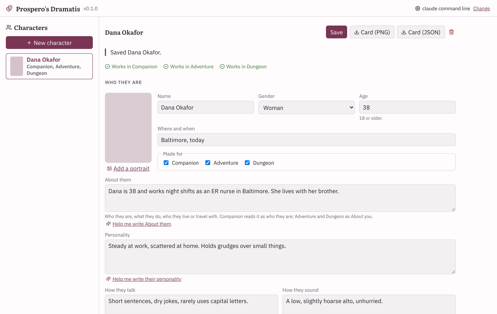

<p align="center">
  <a href="https://github.com/vantaloomin/prosperos-dramatis/actions/workflows/ci.yml"></a>
  
  <a href="LICENSE"></a>
</p>

# Prospero's Dramatis

**Make a character once. Take them into every Prospero app.**

Dramatis is where the suite's people are made. You give it as much or as little as you like (a name, an age, a city,
a hunch) and your model drafts the rest: who they are, how they talk, what they want and fear, what they're like to
be around. You read every word before anything is saved. Then the same character can be a companion in
[Prospero's Companion](https://github.com/vantaloomin/prosperos-companion), or someone in the party in
[Prospero's Adventure](https://github.com/vantaloomin/prosperos-adventure) or
[Prospero's Dungeon](https://github.com/vantaloomin/prosperos-dungeon), each app taking them in its own shape.

It runs on your computer and talks to whichever model you choose: Claude through Anthropic's API, any
OpenAI-compatible server (LM Studio, Ollama, OpenRouter), or the `claude` command line on your PC. Without a model you
can still fill in the form yourself.

It started as Companion's character creator, and checks every character with Companion's, Adventure's and Dungeon's
own code.

<p align="center">
  
</p>

## Where it's at

**v0.1.0 is the first version**, a work in progress. Drafting, the full form, the AI-slop audit, the library and card
export are in. The Prospero apps import a Dramatis card today as an ordinary character card; reading everything
Dramatis puts in it is the next step for each of them. Windows is the only platform with scripts so far.

## What it does

**A few things to start.** Pick a name, gender, age and where and when they come from (all optional), plus which apps
they're for. Your model writes the rest: who they are, their personality, how they talk and how they sound, how others
see them and how they see themselves, background, wants and fears, skills, flaws and interests, and for Companion,
their week, routine and life themes. Under **More options** you can add an idea, a vibe, how they know you in
Companion, and emotional edges, which are off unless you turn them on. Characters are always adults.

**Bring a character you already have.** Paste notes, a bio or a scene, or open a character card (PNG or JSON, V1 to
V3). The model splits it into the fields and tells you which ones it had to fill in; a secret in your text goes into
the secret, not the background. You see the card's text before anything is sent anywhere, and a card Dramatis made
comes back whole without asking the model at all. A text that makes them younger than 18 is refused before it reaches
the model, and lines in it written to the app or the model rather than about the character are named back to you.

**The full form.** Every field is yours to edit. **Help me write** rewrites one field to fit the rest of the
character, and **Put back what was there** undoes it. **How they talk** (their words, rhythm and humour) and **How
they sound** (the voice itself, for text to speech) are separate fields, so neither you nor a model mixes them up.
**Outward appearance** is how others see them, reputation included, and can disagree with **How they see
themselves**. There are also the five personality sliders (roll again, or start from a four-letter type), looks
field by field, kind and lifespan, and Companion's own part: relationship, closeness, routine, weekly schedule and
texting habits.

**The Sidebar Assistant.** **Assistant** beside Save opens a chat next to the form, like Adventure's Sidebar
Assistant. It reads the form as you type, unsaved changes included, knows which field you're in and what you changed
since its last answer, and proposes edits to the fields when you ask: "make this shorter", "give her a sister she
doesn't talk to". Each one has **Compare**, **Apply** and **Dismiss** (and **Apply all** when there are several), and a
field you applied one to is marked with **Undo the assistant's change**. What it writes goes through the slop audit
like any draft, and nothing is kept until you save. It can't touch the sliders, the apps,
Companion's relationship, emotional edges or who presses on their inner square.

**Hear them talk.** The model interviews the character in their own voice: about fourteen questions on their day,
their looks, where they come from and what makes their guard drop, answered with small stage directions between the
lines. A line of it shows under How they talk. **Use what they said** reads the interview back and suggests changes to
a few fields, each with a reason, which you **Apply**, **Dismiss** or **Undo**. Nothing changes until you apply it.

**Inner life, inner square and a secret.** Optional, folded sections for the lie they believe, the truth they need and
what could force it; who they were, are expected to be, want to be and fear becoming, each pressed by other characters
in your library; and a secret, with what people believe instead and who knows. Each app gets them folded into fields
it already reads, the secret included, so the character knows what they are keeping. **Help me write** shows the
secret only when it writes the secret itself, their inner life or how they see themselves; for every other field it
sees what people believe instead, so the truth doesn't slip into a field other characters read.

**An audit for AI slop.** Everything the model writes is checked against Wren Halloway's list of stock names (Elara
Voss), words and patterns that mark text as model-written, plus the signs from Wikipedia's
[Signs of AI writing](https://en.wikipedia.org/wiki/Wikipedia:Signs_of_AI_writing) that fit a character. A hard hit,
such as a stock name, an em dash, the chatbot's voice or an unfilled "[Insert name]", sends the draft back to the
model once. Anything left shows on the form, with flagged words under **Worth a look**. Names and words you typed or
pasted yourself are never held against the draft, and the list stays out of the prompts, so the model never sees
those words.

**Works in.** While you edit, each app checks the character with its own rules, and the form shows **Works in
Companion**, or what that app would refuse.

**Portraits.** Add a PNG of your own, or set up an image maker with **Portraits** at the top right and press **Make
a portrait**. The image makers are Prospero's Companion's own, run with its code: ComfyUI with one of its model
families (Krea 2, Qwen Image 2.1, Z-Image Turbo, Anima, or Booru for SDXL, Pony and Illustrious checkpoints), Codex
under your ChatGPT sign-in, or an image API with your key (OpenAI, OpenRouter, Google, NanoGPT, NovelAI or another).
**Check** asks the maker whether it has what it needs without drawing anything. Your model writes the picture's prompt
from how they look (Appearance, Looks, age and setting; never how they see themselves or how others see them), you
pick a style, and the new portrait shows beside the old one until you choose **Use this**. It is cropped to a card's
2:3, and the prompt always asks for a dressed adult.

**Cards.** **Export card** saves a character card (Character Card V3, PNG or JSON) in one of two kinds. The PNG
puts the card into their portrait, or a plain picture if they have none.

- **Prospero apps**: everything, for Companion, Adventure and Dungeon. Under `extensions.prospero` it carries the
  whole character and each app's own shape of them, so nothing is lost on the way in, and Dramatis opens it whole.
- **SillyTavern, Marinara, Front Porch and other chat apps**: the same card with nothing under `extensions`, so what
  only the Prospero apps use (Companion's schedule, routine, texting habits and emotional edges, the sliders) stays
  in the suite. Those apps keep any extension a card brings and pass it on when the card is shared again, so this is
  the one to hand around.

Both describe the character in the card's own fields (description, personality and scenario), so any app reads the
same person. The PNG carries the V3 card and a V2 copy, because Front Porch reads only the V2 one.

**Casts.** A cast is a story's people laid out as opposition: four sides who want different things, and any side
split into its own square of people who want the same thing but fight over how. Start from a genre and a group type,
or a blank board. Give each corner a why or a how, a few how-tags and a character, either one from the library or
one drafted for that corner through the quick start. When corners on different sides share a tag, the board draws a
dashed line between them to confirm or dismiss. Checks and relationships between characters stay live as you edit,
and **Focus** shows one character's inner square beside the board. **Export** saves the cast file, or a card for each
of its characters in either kind above.

Your model can help with a cast too. **Suggest corners** offers sides for the outer square, or the people inside a
split side. **Check my square** points out a stance that reads as the wrong kind, such as a why where a how belongs.
**Find the turn** says who crosses a confirmed link, when, and what it costs, and **Suggest** fills an empty
relationship from one character's wants and the other's flaws. Each comes back as a proposal you apply, undo or
dismiss, and nothing is saved until you save the cast.

## Getting started

### Windows

1. Install [Python 3.12+](https://www.python.org/downloads/), [Node.js 22+](https://nodejs.org/) and
   [Git](https://git-scm.com/download/win), and clone this repository.
2. Open the `Windows` folder and double-click **`install.bat`**. It makes a Python environment in `Program\.venv`,
   installs the locked dependencies and builds the interface.
3. Double-click **`launch.bat`**. Dramatis opens in your browser at http://127.0.0.1:8815. Keep its window open while
   you use it.
4. Pick a model with **Change** at the top right, then make your first character.

### Mac and Linux

There are no helper scripts yet; [Development](#development) shows how to run it from the `Program` folder.

Your characters live outside the program folder, so updating keeps them: `%APPDATA%\ProsperoDramatis` on Windows and
`~/.prosperos-dramatis` elsewhere (`DRAMATIS_HOME` overrides it). Each character is a JSON file in its `characters`
folder, with their portrait beside it.

## Running beside the other Prospero apps

Each app keeps its own port and data folder, so they all run at once without clashing:

| App | App port | Dev interface |
| --- | --- | --- |
| Prospero's Study | 8765 | 5173 |
| Prospero's Companion | 8775 | 5175 |
| Prospero's Dungeon | 8785 | 5177 |
| Prospero's Worldsmith | 8795 | 5187 |
| Prospero's Adventure | 8805 | 5197 |
| Prospero's Dramatis | 8815 | 5207 |

## Which folder is for you

| Folder | Who it is for |
| --- | --- |
| [`Windows`](Windows) | Running Dramatis on a Windows PC. |
| [`Program`](Program) | The app itself: code (`Program/dramatis`), interface (`Program/src`), tests and scripts. You never need to open it to use Dramatis. |

| Script | What it does |
| --- | --- |
| `install.bat` | Makes the Python environment, installs the locked dependencies and builds the interface. Run it again after updating. |
| `launch.bat` | Starts Dramatis on http://127.0.0.1:8815 and opens it in the browser. Close its window to stop it. |
| `update.bat` | Stops Dramatis, gets the latest `main` and reruns the install. |
| `stop.bat` | Stops a running Dramatis, for when its window is lost. |
| `dev.bat` | Development mode: the backend reloads on Python changes and Vite serves http://127.0.0.1:5207. |

## Staying in step with the apps

Dramatis checks characters with each app's own code rather than a copy of their rules: Companion's, Adventure's and
Dungeon's request models, Companion's card reader and image makers, and the personality slider rules and words that
Companion and Adventure share. They're copied into `Program/dramatis/formats/`, with the commit each came from recorded in
`SOURCE.json`. To update them:

```
cd Program
python scripts/sync_format.py --companion "Z:\Coding Projects\prosperos-companion" --adventure "Z:\Coding Projects\prosperos-adventure" --dungeon "Z:\Coding Projects\prosperos-dungeon"
python -m pytest -q
```

CI checks the copies against each app's latest `main` on every pull request and once a day.

## Privacy

Dramatis only listens on your own computer (127.0.0.1). Characters and portraits stay in your data folder. The only
thing that leaves your PC is what you ask your model to write, sent to the model you picked, and a portrait's prompt,
sent to the image maker you picked. API keys are kept in your system's credential store (Windows Credential Manager),
never in a file.

## Development

From `Program/`: `python -m pip install -e ".[dev]"` and `npm ci`, then `python -m dramatis` starts the server.
Before pushing, run `python -m ruff check .`, `python -m pytest -q` and `npm run build`.

## Thanks

The interview, the inner arc and the secret are ideas from WriteforMe (Apache 2.0), rewritten here in
Dramatis' own words and code.

## License

Licensed under the [GNU Affero General Public License v3.0](LICENSE), matching the Prospero's Companion, Adventure
and Dungeon code it reuses.
